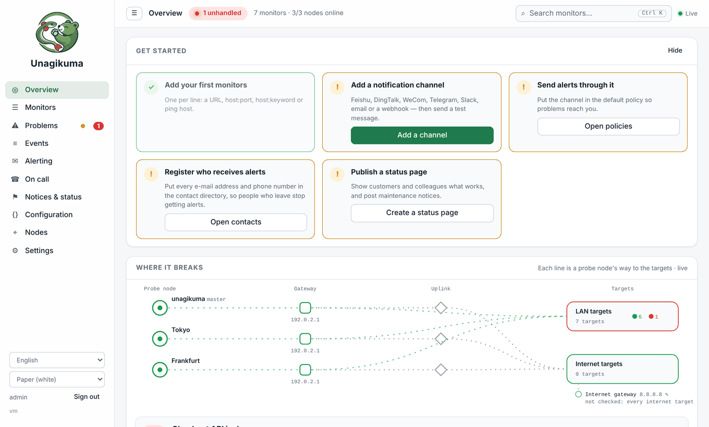
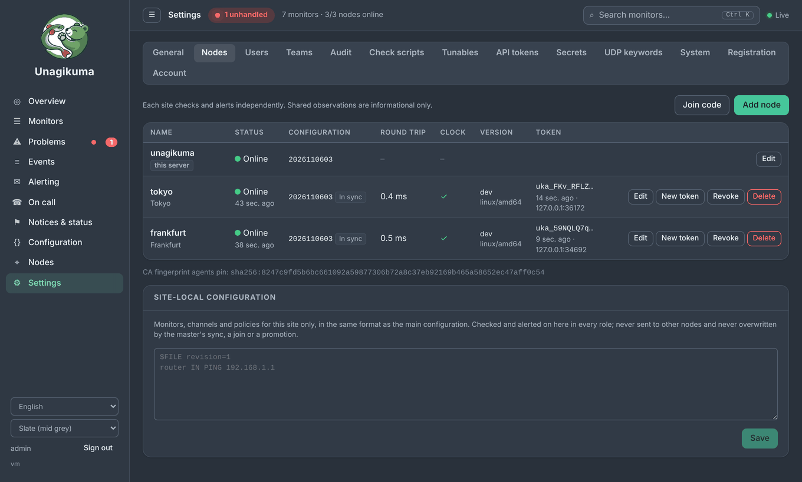

# Unagikuma

<p align="center"></p>

**Otra herramienta más para comprobar la disponibilidad: u(ptime) + nagi(os) + kuma(Uptime Kuma).**

Monitorización autoalojada y sencilla: entérate en cuanto tus webs o servidores caen, sin ruido.

[English](README.md) · [中文](README.zh.md) · [हिन्दी](README.hi.md) · **Español** · [العربية](README.ar.md) · [Français](README.fr.md) · [বাংলা](README.bn.md) · [Português](README.pt.md) · [Русский](README.ru.md) · [Bahasa Indonesia](README.id.md) · [اردو](README.ur.md) · [Deutsch](README.de.md) · [日本語](README.ja.md) · [Tiếng Việt](README.vi.md) · [한국어](README.ko.md)


## ¿Por qué Unagikuma?

- **Listo en unos 30 segundos.** Descarga un archivo, ejecútalo y abre el navegador.
- **Un solo archivo, nada más que instalar.** Funciona en Linux, macOS, Windows y FreeBSD.
- **Vigila lo importante.** Sitios web, servidores, puertos, ping, DNS, certificados SSL y caducidad de dominios.
- **Alertas donde ya estás.** Correo, Telegram, Slack, Discord, Feishu, DingTalk, WeCom, webhooks y más.
- **Un problema, no una avalancha de alertas.** Si se cae tu propia red, Unagikuma se da cuenta y no te avisa por cada monitor.
- **Páginas de estado** para mantener informados a tus usuarios.
- **Crece contigo.** Añade una segunda máquina o un clúster entero en un minuto cuando lo necesites, con un código desde la página web.
- **Cambiarse es fácil.** Trae tus monitores desde Uptime Kuma o Nagios.
- **Habla tu idioma.** La interfaz está disponible en 15 idiomas.

## Primeros pasos

**1.** Descarga el archivo para tu sistema desde [Releases](https://github.com/githubflyideas/unagikuma/releases/latest) y descomprímelo.

**2.** Ejecútalo:

```sh
./unagikuma
```

En Windows, ejecuta `unagikuma.exe`.

**3.** Abre http://localhost:8077 en el navegador y crea tu cuenta de administrador.

**4.** Haz clic en **Añadir monitor**, escribe la dirección de una web y listo.

> ¿Lo abres desde otro ordenador? Entra en `http://<dirección-del-servidor>:8077` e introduce el **Token de configuración** que mostró el programa al arrancar por primera vez.

## Una máquina, dos máquinas, un clúster

> **Nadar y guardar la ropa.** La mayoría de las herramientas te obligan a elegir: una pequeña, fácil de arrancar pero atada a una máquina, o una grande que escala pero pide base de datos, agentes y una tarde de configuración. Unagikuma es las dos cosas. Empieza con un archivo en una máquina; cuando quieras más, une otras máquinas. El mismo programa, la misma interfaz, nada que migrar.

Unagikuma está hecho ante todo para una sola máquina. Allí funciona todo: comprobaciones, alertas, páginas de estado, historial. Más máquinas solo añaden más puntos de vista.

### Una máquina: lista al instante

Ejecuta el archivo y añade un monitor. No hay nada más que preparar: ni base de datos, ni agentes, ni segundo servidor. Así lo usa la mayoría, y basta por sí solo.



### Dos máquinas: cada una vigila por su cuenta

Pon un segundo servidor en otro lugar, por ejemplo en otra oficina o con otro proveedor. En el primero abre **Ajustes › Nodos › Código de unión**; en el segundo, **Ajustes › Nodos › Unirse a clúster** y pega el código. El segundo servidor recibe al momento una copia de la configuración y empieza a comprobar enseguida.

- **Ambos servidores comprueban y alertan de forma independiente.** Si uno cae, el otro sigue funcionando y enviando alertas.
- **Sin adivinar.** Cuando dos servidores se pierden de vista, ninguno puede saber qué lado quedó aislado, así que ninguno declara muerto al otro. Ambos siguen comprobando y alertando por su cuenta.
- **Cada mensaje indica su sitio** (`[Tokyo] …`), para que siempre sepas de dónde viene una alerta.

### Un clúster: todos los sitios, una sola imagen

Añade tantos sitios como quieras de la misma forma. Cada sitio sigue comprobando y alertando por sí mismo, así que perder cualquiera, incluido el servidor principal, nunca detiene la monitorización. Lo que aporta el clúster es contexto: cada monitor y cada alerta muestran lo que ven ahora los demás sitios.


- **¿«Caído en todas partes» o «caído desde aquí»?** Las observaciones de cada sitio muestran de un vistazo si un servicio está realmente caído o solo falla una ruta de red. Los resultados desactualizados se marcan como tales.
- **Un sitio que deja de responder se avisa una sola vez,** al cabo de un minuto (ajustable), con un aviso de recuperación cuando vuelve. Reiniciar el servidor principal no provoca una ola de «sitio inalcanzable».
- **Los cambios llegan a todos los sitios en segundos,** y cada sitio puede tener monitores propios, como el router de esa oficina.



## Avalanchas de alertas: un problema, un mensaje

Una herramienta que te avisa cien veces por un cable roto acaba silenciada, y entonces no sirve. Unagikuma trata una avalancha de alertas como un fallo que hay que evitar:

- **Primero tu propia red.** Cuando esta máquina pierde su propia conexión a internet, Unagikuma ve que todos sus destinos fallaron a la vez y envía un mensaje sobre la red en lugar de uno por monitor. Cuando la red vuelve, los monitores retenidos se comprueban de nuevo poco a poco antes de informar nada.
- **Padres antes que hijos.** Cuando un host está caído, sus servicios no se avisan uno por uno.
- **Como mucho tres alertas por minuto y canal.** Lo demás se reúne en un solo resumen al final del minuto, lo más grave primero. Los problemas nuevos tienen su propio cupo, así que los recordatorios nunca los retrasan, pero cien servicios cayendo a la vez llegan igualmente como un resumen, no como cien mensajes.
- **Las buenas noticias nunca se retienen.** Las recuperaciones y escaladas salen siempre al instante: nunca esperas el mensaje que te dice que puedes parar.
- **Las intermitencias se resumen.** Un servicio que sube y baja se informa como un solo incidente con un contador.
- **El trabajo planificado no hace ruido.** Las ventanas de mantenimiento silencian aquello en lo que anunciaste que ibas a trabajar.

Todos los límites se ajustan en **Ajustes › Parámetros**.

## Cambiar desde Uptime Kuma

Detén Uptime Kuma y revisa primero (no se cambia nada):

```sh
./unagikuma import kuma --dry-run /path/to/uptime-kuma/data/kuma.db
```

Si todo se ve bien, importa:

```sh
./unagikuma import kuma /path/to/uptime-kuma/data/kuma.db
```

El informe muestra qué se importó, qué conviene revisar y qué no se pudo importar, con qué hacer en cada caso. También se guarda en `data/import-reports/`. Si lo ejecutas de nuevo, solo añade lo nuevo.

## Cambiar desde Nagios

Indica tu `nagios.cfg` y revisa primero (no se cambia nada):

```sh
./unagikuma import nagios --dry-run /etc/nagios4/nagios.cfg
```

Si todo se ve bien, importa:

```sh
./unagikuma import nagios /etc/nagios4/nagios.cfg
```

El informe muestra qué se importó, qué conviene revisar y qué no se pudo importar, con qué hacer en cada caso. También se guarda en `data/import-reports/`. Si lo ejecutas de nuevo, solo añade lo nuevo.

## ¿Olvidaste tu contraseña?

En la máquina donde se ejecuta Unagikuma:

```sh
./unagikuma reset-password admin
```

Escribe la nueva contraseña dos veces (no se muestra). Añade `--generate` para obtener una aleatoria.

## Más información

- [Manual de usuario (en inglés)](docs/manual.md) — todo lo demás, paso a paso
- [Registro de cambios](CHANGELOG.md)

## Licencia

Apache License 2.0, consulta [LICENSE](LICENSE).
