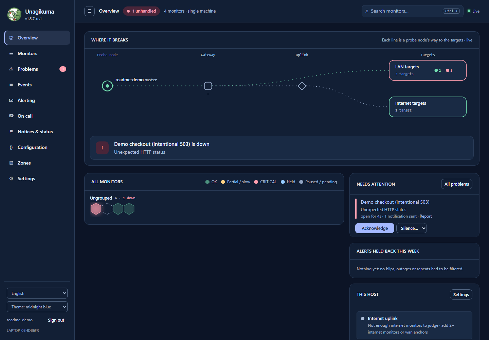
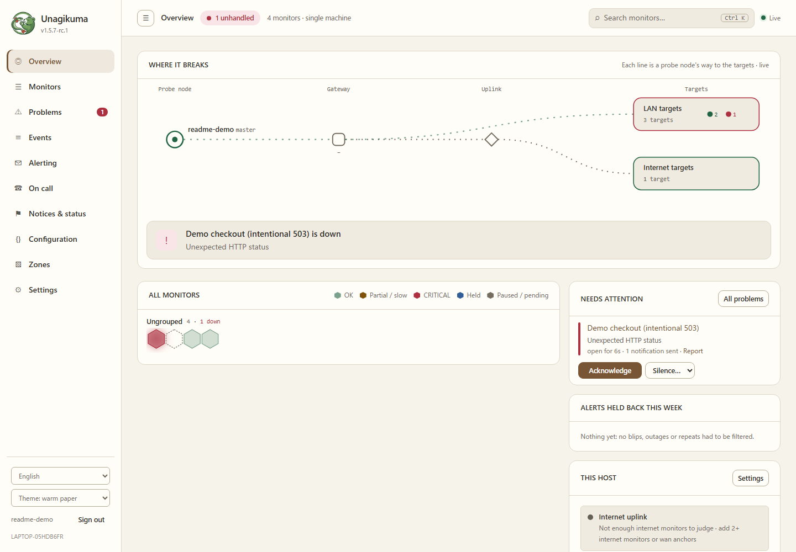
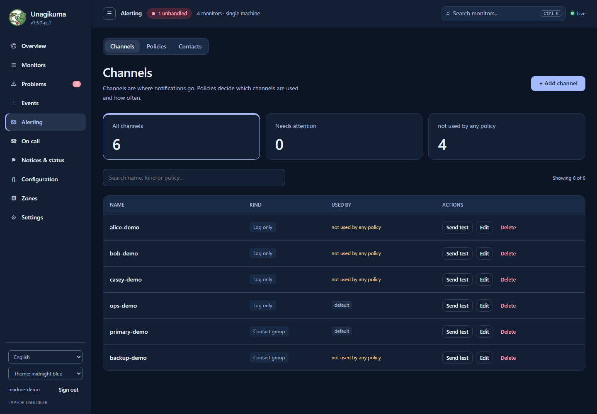
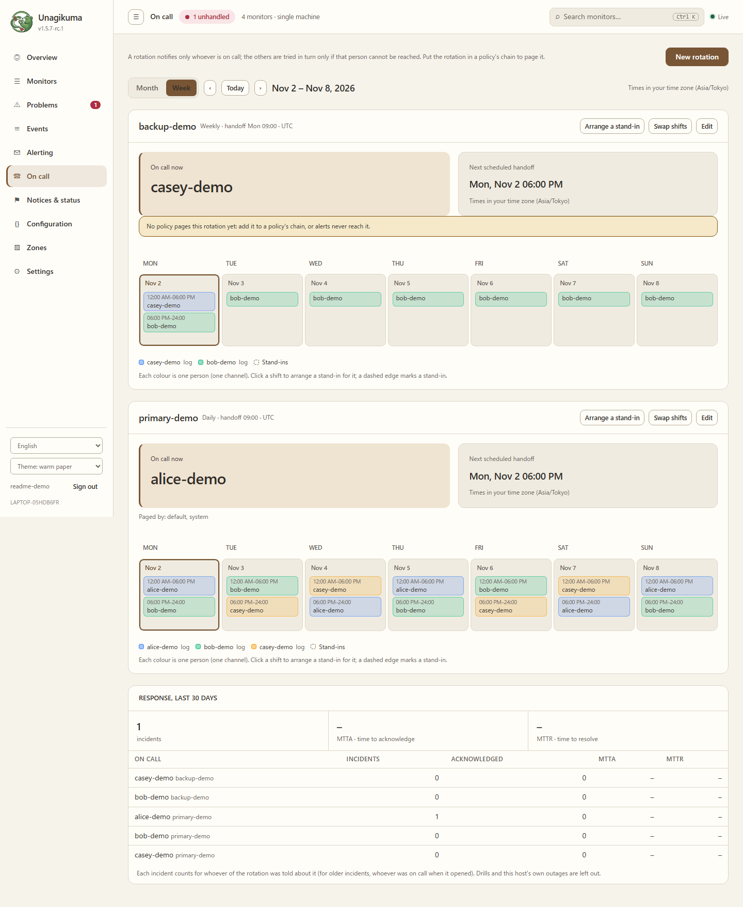
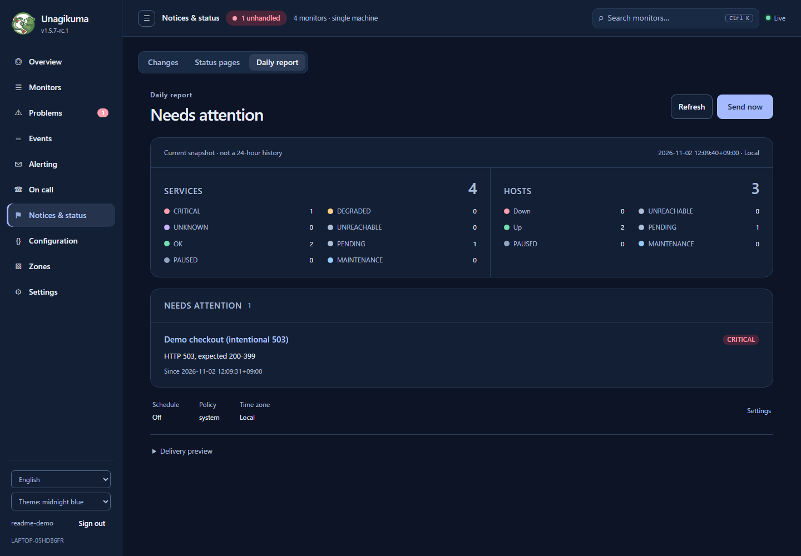
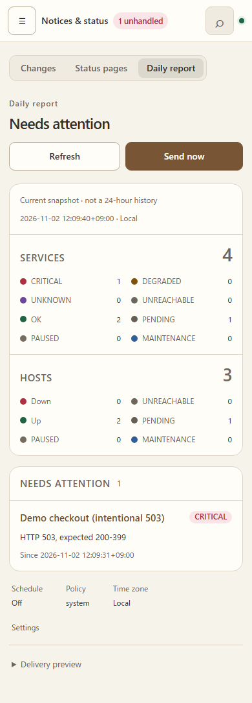

# Unagikuma

<p align="center"></p>

**もうひとつの死活監視ツール:u(ptime) + nagi(os) + kuma(Uptime Kuma)。**

かんたんなセルフホスト型監視。サイトやサーバーが落ちたらすぐに気づけて、通知でうるさくなりません。

[English](README.md) · [中文](README.zh.md) · [हिन्दी](README.hi.md) · [Español](README.es.md) · [العربية](README.ar.md) · [Français](README.fr.md) · [বাংলা](README.bn.md) · [Português](README.pt.md) · [Русский](README.ru.md) · [Bahasa Indonesia](README.id.md) · [اردو](README.ur.md) · [Deutsch](README.de.md) · **日本語** · [Tiếng Việt](README.vi.md) · [한국어](README.ko.md)

## 現在の画面

> 展開した v1.5.7-rc.1 Windows リリース候補パッケージの実際のローカルバックエンドを、使い捨てのデモデータで撮影しています。通知はローカルログのみ。実運用の障害や最終リリース版の画像ではありません。



<details>
<summary>テーマ、通知先、当番ローテーション、日次レポート、モバイル画面</summary>

**ペーパーテーマの概要**



**通知先**



**当番カレンダー**



**日次レポート：24時間の履歴ではなく現在のスナップショット**



**モバイルのレポート**



</details>

## Unagikuma が選ばれる理由

- **約 30 秒で使い始められます。** ファイルを 1 つダウンロードして実行し、ブラウザーを開くだけ。
- **ファイルは 1 つだけ。ほかに入れるものはありません。** Linux、macOS、Windows、FreeBSD で動きます。
- **大事なところをしっかり監視。** Web サイト、サーバー、ポート、Ping、DNS、SSL 証明書、ドメインの有効期限。
- **いつも使っている場所に通知。** メール、Telegram、Slack、Discord、Feishu、DingTalk、WeCom、Webhook など。
- **問題は 1 つ、通知の嵐にはなりません。** 自分側のネットワークが落ちたときは Unagikuma がそれに気づき、監視ごとに通知を送ることはしません。
- **ステータスページ**で、利用者にいつでも状況を伝えられます。
- **規模に合わせて拡張。** 必要になったら複数の拠点から監視できます(プレビュー)。
- **乗り換えもかんたん。** Uptime Kuma や Nagios から監視設定を取り込めます。
- **あなたの言語で。** 画面は 15 の言語に対応しています。

## クイックスタート

**1.** [Releases](https://github.com/githubflyideas/unagikuma/releases/latest) からお使いのシステム用のファイルをダウンロードして展開します。

**2.** 実行します:

```sh
./unagikuma
```

Windows では `unagikuma.exe` を実行します。

**3.** ブラウザーで http://localhost:8077 を開き、管理者アカウントを作成します。

**4.** **監視を追加** をクリックし、Web サイトのアドレスを入力すれば完了です。

> 別のパソコンから開く場合は `http://<サーバーのアドレス>:8077` にアクセスし、初回起動時にプログラムが表示した **セットアップトークン** を入力してください。

## Docker で動かすなら

```sh
docker run -d --name unagikuma -p 8077:8077 -v unagikuma-data:/data ghcr.io/githubflyideas/unagikuma:latest
```

そのあと http://localhost:8077 を開きます。**セットアップトークン** は `docker logs unagikuma` で確認できます。

## Uptime Kuma からの移行

Uptime Kuma を止めてから、まず確認します(何も変更されません):

```sh
./unagikuma import kuma --dry-run /path/to/uptime-kuma/data/kuma.db
```

問題なければ取り込みます:

```sh
./unagikuma import kuma /path/to/uptime-kuma/data/kuma.db
```

レポートには、取り込んだもの、確認が必要なもの、取り込めなかったものと、その対処方法が表示されます。`data/import-reports/` にも保存されます。もう一度実行しても新しいものだけが追加されます。

## Nagios からの移行

`nagios.cfg` を指定して、まず確認します(何も変更されません):

```sh
./unagikuma import nagios --dry-run /etc/nagios4/nagios.cfg
```

問題なければ取り込みます:

```sh
./unagikuma import nagios /etc/nagios4/nagios.cfg
```

レポートには、取り込んだもの、確認が必要なもの、取り込めなかったものと、その対処方法が表示されます。`data/import-reports/` にも保存されます。もう一度実行しても新しいものだけが追加されます。

## パスワードを忘れたら

Unagikuma が動いているマシンで実行します:

```sh
./unagikuma reset-password admin
```

新しいパスワードを 2 回入力します(画面には表示されません)。代わりにランダムなパスワードを作るには `--generate` を付けます。Docker の場合:

```sh
docker exec -it unagikuma /unagikuma reset-password admin
```

## さらに詳しく

- [ユーザーマニュアル(英語)](docs/manual.md) — そのほかのすべてを順を追って説明
- [変更履歴](CHANGELOG.md)

## ライセンス

Apache License 2.0。詳しくは [LICENSE](LICENSE) をご覧ください。
