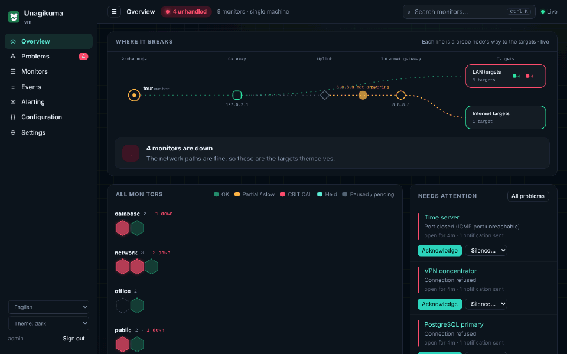

# Unagikuma

<p align="center"></p>

**또 하나의 가동 상태 점검 도구: u(ptime) + nagi(os) + kuma(Uptime Kuma).**

쉽고 간편한 셀프 호스팅 모니터링: 웹사이트나 서버가 다운되면 바로 알 수 있고, 알림 폭탄은 없습니다.

[English](README.md) · [中文](README.zh.md) · [हिन्दी](README.hi.md) · [Español](README.es.md) · [العربية](README.ar.md) · [Français](README.fr.md) · [বাংলা](README.bn.md) · [Português](README.pt.md) · [Русский](README.ru.md) · [Bahasa Indonesia](README.id.md) · [اردو](README.ur.md) · [Deutsch](README.de.md) · [日本語](README.ja.md) · [Tiếng Việt](README.vi.md) · **한국어**



## Unagikuma를 써야 하는 이유

- **약 30초면 준비 완료.** 파일 하나를 내려받아 실행하고 브라우저를 열면 끝입니다.
- **파일 하나, 따로 설치할 것 없음.** Linux, macOS, Windows, FreeBSD에서 동작합니다.
- **중요한 것을 확인합니다.** 웹사이트, 서버, 포트, ping, DNS, SSL 인증서, 도메인 만료일.
- **늘 쓰는 곳으로 알림.** 이메일, Telegram, Slack, Discord, Feishu, DingTalk, WeCom, 웹훅 등.
- **문제는 하나, 알림 폭탄은 없습니다.** 내 쪽 네트워크가 끊기면 Unagikuma가 이를 알아차리고 모니터마다 알림을 보내지 않습니다.
- **상태 페이지**로 사용자에게 언제나 상황을 알려 줍니다.
- **함께 성장합니다.** 필요할 때 여러 위치에서 확인할 수 있습니다(미리 보기).
- **옮겨 오기 쉽습니다.** Uptime Kuma나 Nagios의 모니터를 가져올 수 있습니다(미리 보기).
- **내 언어로.** 화면은 15개 언어를 지원합니다.

## 빠른 시작

**1.** [Releases](https://github.com/githubflyideas/unagikuma/releases/latest)에서 내 시스템에 맞는 파일을 내려받아 압축을 풉니다.

**2.** 실행합니다:

```sh
./unagikuma
```

Windows에서는 `unagikuma.exe`를 실행합니다.

**3.** 브라우저에서 http://localhost:8077 을 열고 관리자 계정을 만듭니다.

**4.** **모니터 추가**를 누르고 웹사이트 주소를 입력하면 끝입니다.

> 다른 컴퓨터에서 여나요? `http://<서버-주소>:8077`에 접속해 프로그램이 처음 시작할 때 보여 준 **설정 토큰**을 입력하세요.

## Docker가 편하다면

```sh
docker run -d --name unagikuma -p 8077:8077 -v unagikuma-data:/data ghcr.io/githubflyideas/unagikuma:latest
```

그다음 http://localhost:8077 을 엽니다. **설정 토큰**은 `docker logs unagikuma`로 확인할 수 있습니다.

## 더 알아보기

- [사용자 설명서(영어)](docs/manual.md) — 나머지 모든 내용을 단계별로
- [변경 내역](CHANGELOG.md)

## 라이선스

Apache License 2.0, [LICENSE](LICENSE)를 참고하세요.
