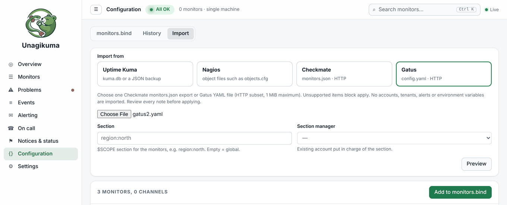

# Unagikuma

<p align="center"></p>

**Yet another uptime check tool: u(ptime) + nagi(os) + kuma(Uptime Kuma).**

**Have your cake and eat it too:** one file on one machine works out of the box, and when you want more, join other machines and it becomes a cluster. Same program, nothing to migrate.

Friendly, self-hosted monitoring: know the moment your websites and servers go down, without the noise.

**English** · [中文](README.zh.md) · [हिन्दी](README.hi.md) · [Español](README.es.md) · [العربية](README.ar.md) · [Français](README.fr.md) · [বাংলা](README.bn.md) · [Português](README.pt.md) · [Русский](README.ru.md) · [Bahasa Indonesia](README.id.md) · [اردو](README.ur.md) · [Deutsch](README.de.md) · [日本語](README.ja.md) · [Tiếng Việt](README.vi.md) · [한국어](README.ko.md)


## Why Unagikuma

- **Ready in about 30 seconds.** Download one file, run it, open your browser.
- **One file, nothing else to install.** Works on Linux, macOS, Windows and FreeBSD.
- **Checks what matters.** Websites, servers, ports, ping, DNS, SSL certificates and domain expiry.
- **Alerts where you already are.** Email, Telegram, Slack, Discord, Feishu, DingTalk, WeCom, webhooks and more.
- **Status pages** to keep your users in the loop.
- **Easy to switch.** Bring your monitors over from Uptime Kuma, Nagios, Checkmate or Gatus, in the web page or on the command line.
- **Seven themes, or your own.** Five tones from white to black (Paper, Mist, Slate, Graphite, Ink) plus Sky and Violet, with Nagios-style status colours; upload a theme pack for your own colours, and with a registration your own product name and logo.
- **Speaks your language.** The interface comes in 15 languages.

## Quick start

**1.** Download the file for your system from [Releases](https://github.com/githubflyideas/unagikuma/releases/latest) and unpack it.

**2.** Run it:

```sh
./unagikuma
```

On Windows, run `unagikuma.exe`.

**3.** Open http://localhost:8077 in your browser and create your admin account.

**4.** Click **Add monitor**, enter a website address, and you're done.

> Opening it from another computer? Use `http://<server-address>:8077` and enter the **Setup token** that the program printed when it first started.

## One machine, two machines, a cluster

- **One machine:** run the file, add a monitor, done. No database, no agents.
- **Two machines:** paste a join code under **Settings › Nodes**. Each machine checks and alerts on its own, so either one can go down without silencing your alerts.
- **A cluster:** add as many sites as you like. Every alert shows what each site sees, so you can tell "down everywhere" from "down from here".


## No alert floods

- **Your own network is down?** One message about the network, not one per monitor.
- **A host is down?** Its services are not reported one by one.
- **At most three alerts a minute per channel;** the rest arrive as one summary. Recoveries always go out at once.

## Moving from another tool

In the web page, open **Configuration › Import**, pick Uptime Kuma, Nagios, Checkmate or Gatus, upload the file, check the preview and add it.



Or on the command line: look first with `--dry-run` (nothing is changed), then run the same command without it.

```sh
./unagikuma import kuma      --dry-run /path/to/kuma.db
./unagikuma import nagios    --dry-run /etc/nagios4/nagios.cfg
./unagikuma import checkmate --dry-run monitors.json
./unagikuma import gatus     --dry-run config.yaml
```

Checkmate and Gatus: HTTP checks are moved. Anything that cannot be moved exactly is listed and stops the import, so nothing is half-done.

## Forgot your password?

On the machine where Unagikuma runs:

```sh
./unagikuma reset-password admin
```

Type the new password twice (it is not shown). Add `--generate` to get a random one instead.

## Learn more

- [User manual](docs/manual.md) — everything else, step by step
- [Changelog](CHANGELOG.md)

## License

Apache License 2.0, see [LICENSE](LICENSE).
