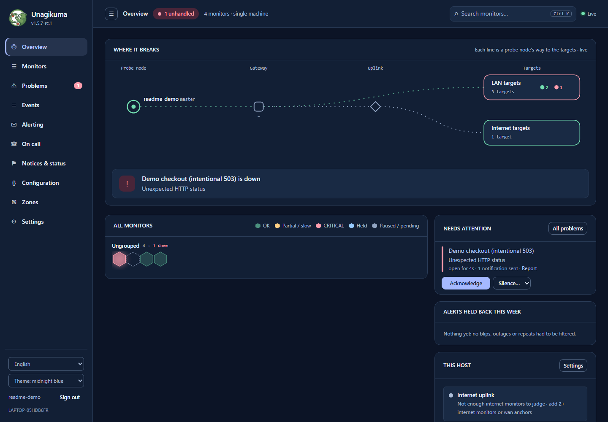
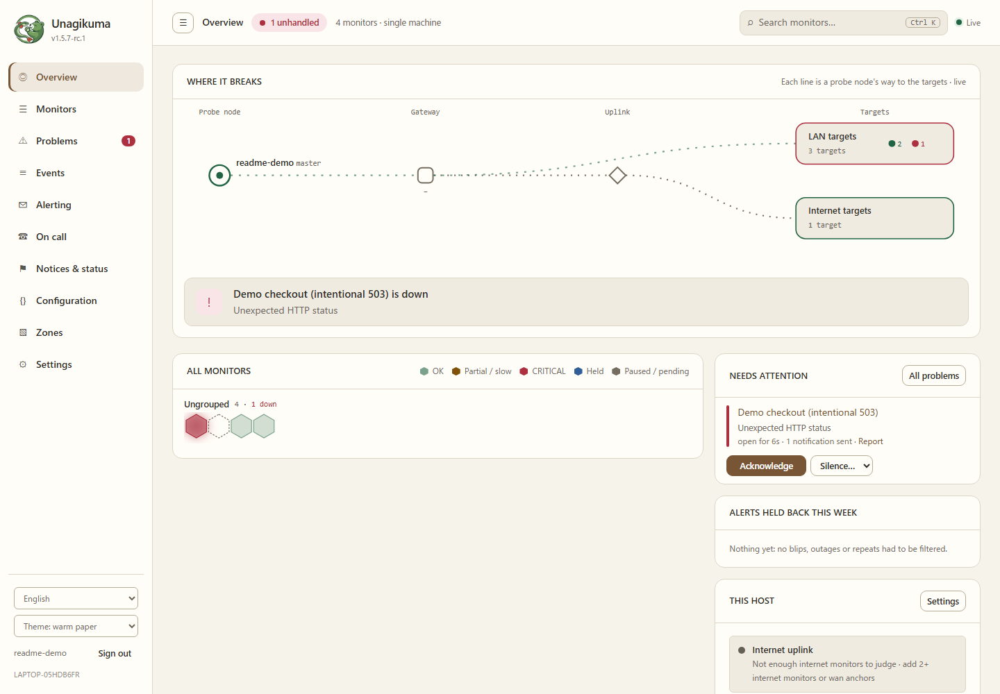
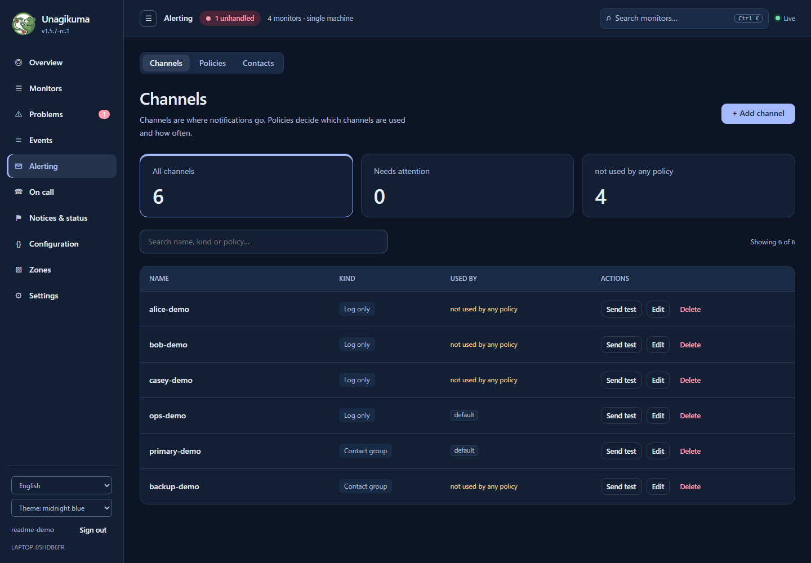
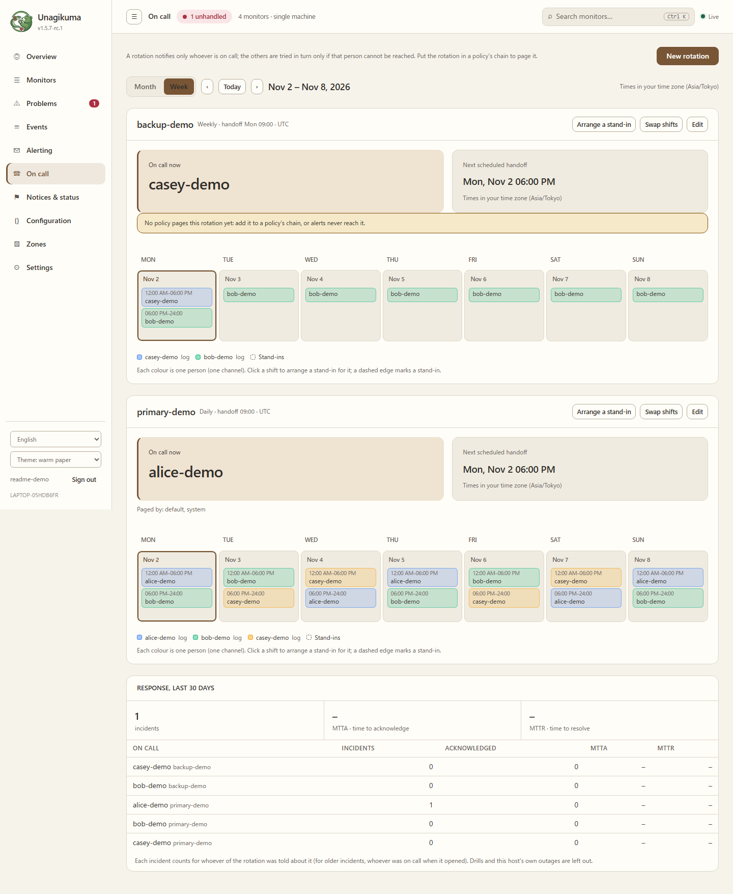
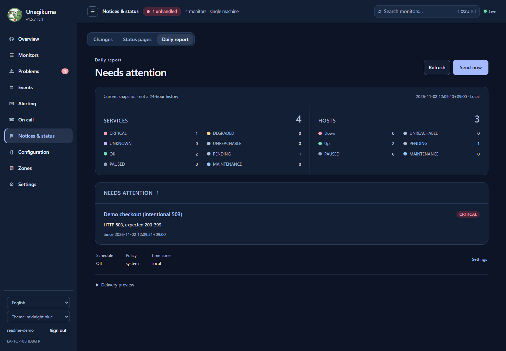
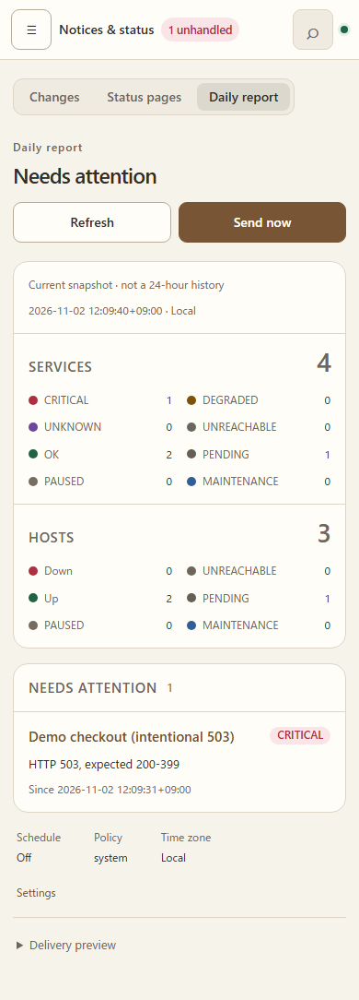

# Unagikuma

<p align="center"></p>

**Yet another uptime check tool: u(ptime) + nagi(os) + kuma(Uptime Kuma).**

Friendly, self-hosted monitoring: know the moment your websites and servers go down, without the noise.

**English** · [中文](README.zh.md) · [हिन्दी](README.hi.md) · [Español](README.es.md) · [العربية](README.ar.md) · [Français](README.fr.md) · [বাংলা](README.bn.md) · [Português](README.pt.md) · [Русский](README.ru.md) · [Bahasa Indonesia](README.id.md) · [اردو](README.ur.md) · [Deutsch](README.de.md) · [日本語](README.ja.md) · [Tiếng Việt](README.vi.md) · [한국어](README.ko.md)

## Current interface

> Captured from the extracted v1.5.7-rc.1 Windows candidate package, using a real local backend and disposable illustrative demo data. Notifications go to local logs only; these are not production incidents or final-release screenshots.



<details>
<summary>Themes, alert channels, on-call rotations, daily report and mobile view</summary>

**Paper dashboard**



**Alert channels**



**On-call calendar**



**Daily report — current snapshot, not 24-hour history**



**Mobile report**



</details>

## Why Unagikuma

- **Ready in about 30 seconds.** Download one file, run it, open your browser.
- **One file, nothing else to install.** Works on Linux, macOS, Windows and FreeBSD.
- **Checks what matters.** Websites, servers, ports, ping, DNS, SSL certificates and domain expiry.
- **Alerts where you already are.** Email, Telegram, Slack, Discord, Feishu, DingTalk, WeCom, webhooks and more.
- **One problem, not a flood of alerts.** If your own network goes down, Unagikuma notices and doesn't page you for every single monitor.
- **Status pages** to keep your users in the loop.
- **Grows with you.** Check from several locations when you need to (preview).
- **Easy to switch.** Bring your monitors over from Uptime Kuma or Nagios.
- **Speaks your language.** The interface comes in 15 languages.
- **A console for daily operations.** Dark, light, midnight blue and warm paper themes, with responsive navigation for smaller screens.
- **Alerts and on-call in one place.** Search notification channels, see policy usage, and manage rotations with a calendar, stand-ins and shift swaps.
- **An honest daily report.** Preview current service and host states, see outstanding issues, and queue the report for delivery. It is a current snapshot, not a 24-hour uptime/history report.

> **Preview boundary:** multi-location monitoring remains a preview. Zone synchronization, invitations and voting are still being integrated; this README does not promise full HA, automatic consensus/failover, or script upload. Screenshots above document the extracted v1.5.7-rc.1 Windows candidate package, not a final release or multi-platform acceptance.

## Quick start

**1.** Download the file for your system from [Releases](https://github.com/githubflyideas/unagikuma/releases/latest) and unpack it.

**2.** Run it:

```sh
./unagikuma
```

On Windows, run `unagikuma.exe`.

**3.** Open http://localhost:8077 in your browser and create your admin account.

**4.** Click **Add monitor**, enter a website address, and you're done.

> Opening it from another computer? Use `http://<server-address>:8077` and enter the **Setup token** that the program printed when it first started.

## Prefer Docker?

```sh
docker run -d --name unagikuma -p 8077:8077 -v unagikuma-data:/data ghcr.io/githubflyideas/unagikuma:latest
```

Then open http://localhost:8077. You'll find the **Setup token** with `docker logs unagikuma`.

## Moving from Uptime Kuma

Stop Uptime Kuma, then look first (nothing is changed):

```sh
./unagikuma import kuma --dry-run /path/to/uptime-kuma/data/kuma.db
```

If it looks right, import:

```sh
./unagikuma import kuma /path/to/uptime-kuma/data/kuma.db
```

The report lists what was imported, what needs a look and what could not be imported, with what to do. It is also saved in `data/import-reports/`. Running it again only adds what is new.

## Moving from Nagios

Point it at `nagios.cfg` and look first (nothing is changed):

```sh
./unagikuma import nagios --dry-run /etc/nagios4/nagios.cfg
```

If it looks right, import:

```sh
./unagikuma import nagios /etc/nagios4/nagios.cfg
```

The report lists what was imported, what needs a look and what could not be imported, with what to do. It is also saved in `data/import-reports/`. Running it again only adds what is new.

## Moving from Checkmate or Gatus

Configuration → Import also accepts bluewave-labs/Checkmate `monitors.json` exports and Gatus endpoint YAML. These are **bounded HTTP adapters**, not full migrations: unsupported checks/conditions and name collisions block apply. Preview first:

```sh
./unagikuma import checkmate --dry-run monitors.json
./unagikuma import gatus --dry-run config.yaml
```

See [supported fields, safety limits and tenant-scope limitations](docs/import-adapters.md) before applying. Kuma/Nagios repeat-import behavior above does not apply to these adapters; existing record-name collisions are reported explicitly.

## Forgot your password?

On the machine where Unagikuma runs:

```sh
./unagikuma reset-password admin
```

Type the new password twice (it is not shown). Add `--generate` to get a random one instead. With Docker:

```sh
docker exec -it unagikuma /unagikuma reset-password admin
```

## Learn more

- [User manual](docs/manual.md) — everything else, step by step
- [Changelog](CHANGELOG.md)

## License

Apache License 2.0, see [LICENSE](LICENSE).
