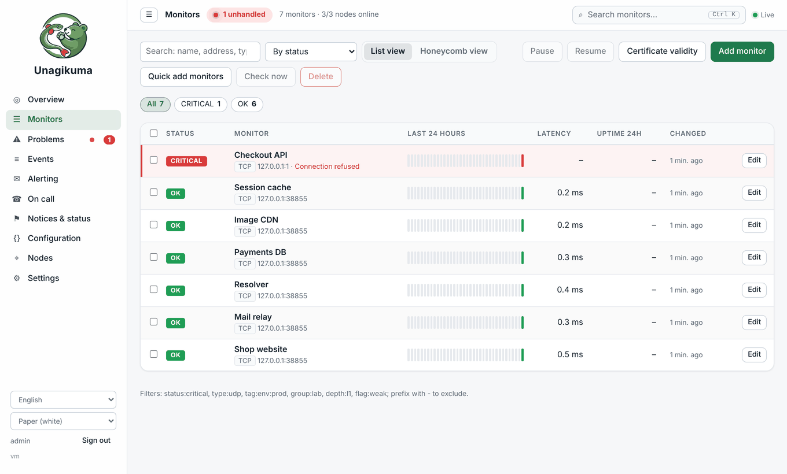
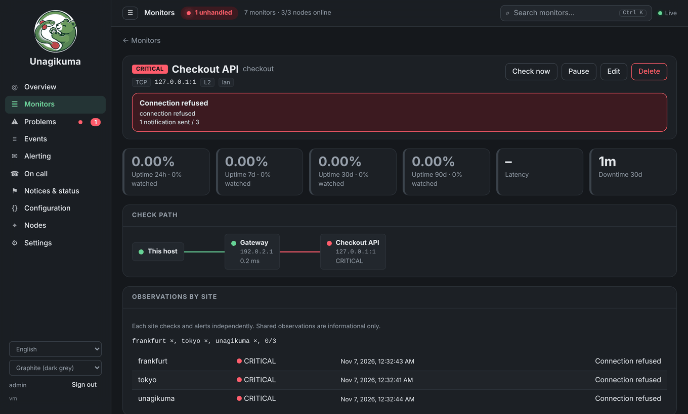

# Unagikuma

<p align="center"></p>

**Mais uma ferramenta de verificação de disponibilidade: u(ptime) + nagi(os) + kuma(Uptime Kuma).**

**O melhor dos dois mundos:** um arquivo em uma máquina funciona na hora; quando quiser mais, junte outras máquinas e vira um cluster. O mesmo programa, nada para migrar.

Monitoramento auto-hospedado e descomplicado: saiba na hora quando seus sites e servidores caem, sem barulho.

[English](README.md) · [中文](README.zh.md) · [हिन्दी](README.hi.md) · [Español](README.es.md) · [العربية](README.ar.md) · [Français](README.fr.md) · [বাংলা](README.bn.md) · **Português** · [Русский](README.ru.md) · [Bahasa Indonesia](README.id.md) · [اردو](README.ur.md) · [Deutsch](README.de.md) · [日本語](README.ja.md) · [Tiếng Việt](README.vi.md) · [한국어](README.ko.md)



## Por que o Unagikuma

- **Pronto em cerca de 30 segundos.** Baixe um arquivo, execute e abra o navegador.
- **Um único arquivo, nada mais para instalar.** Funciona em Linux, macOS, Windows e FreeBSD.
- **Verifica o que importa.** Sites, servidores, portas, ping, DNS, certificados SSL e vencimento de domínios.
- **Alertas onde você já está.** E-mail, Telegram, Slack, Discord, Feishu, DingTalk, WeCom, webhooks e muito mais.
- **Páginas de status** para manter seus usuários informados.
- **Fácil de migrar.** Traga seus monitores do Uptime Kuma ou do Nagios.
- **Fala a sua língua.** A interface está disponível em 15 idiomas.

## Primeiros passos

**1.** Baixe o arquivo para o seu sistema em [Releases](https://github.com/githubflyideas/unagikuma/releases/latest) e descompacte.

**2.** Execute:

```sh
./unagikuma
```

No Windows, execute `unagikuma.exe`.

**3.** Abra http://localhost:8077 no navegador e crie sua conta de administrador.

**4.** Clique em **Adicionar monitor**, digite o endereço de um site e pronto.

> Vai abrir de outro computador? Acesse `http://<endereço-do-servidor>:8077` e informe o **Token de instalação** que o programa mostrou ao iniciar pela primeira vez.

## Uma máquina, duas máquinas, um cluster

- **Uma máquina:** execute o arquivo, adicione um monitor e pronto. Sem banco de dados, sem agentes.
- **Duas máquinas:** cole um código de adesão em **Ajustes › Nós**. Cada máquina verifica e alerta por conta própria; se uma cair, os alertas continuam.
- **Um cluster:** adicione quantos sites quiser. Cada alerta mostra o que cada site vê, para distinguir "fora do ar em todo lugar" de "fora do ar daqui".



## Sem enxurrada de alertas

- **Sua própria rede caiu?** Uma mensagem sobre a rede, não uma por monitor.
- **Um host caiu?** Os serviços dele não são avisados um a um.
- **No máximo três alertas por minuto por canal;** o resto chega em um único resumo. Recuperações sempre saem na hora.

## Vindo do Uptime Kuma

Pare o Uptime Kuma e confira antes (nada é alterado):

```sh
./unagikuma import kuma --dry-run /path/to/uptime-kuma/data/kuma.db
```

Se estiver tudo certo, importe:

```sh
./unagikuma import kuma /path/to/uptime-kuma/data/kuma.db
```

O relatório mostra o que foi importado, o que precisa de atenção e o que não pôde ser importado, com o que fazer. Ele também é salvo em `data/import-reports/`. Rodar de novo só adiciona o que for novo.

## Vindo do Nagios

Aponte para o seu `nagios.cfg` e confira antes (nada é alterado):

```sh
./unagikuma import nagios --dry-run /etc/nagios4/nagios.cfg
```

Se estiver tudo certo, importe:

```sh
./unagikuma import nagios /etc/nagios4/nagios.cfg
```

O relatório mostra o que foi importado, o que precisa de atenção e o que não pôde ser importado, com o que fazer. Ele também é salvo em `data/import-reports/`. Rodar de novo só adiciona o que for novo.

## Esqueceu a senha?

Na máquina onde o Unagikuma roda:

```sh
./unagikuma reset-password admin
```

Digite a nova senha duas vezes (ela não aparece). Adicione `--generate` para receber uma aleatória.

## Saiba mais

- [Manual do usuário (em inglês)](docs/manual.md) — todo o resto, passo a passo
- [Histórico de mudanças](CHANGELOG.md)

## Licença

Apache License 2.0, veja [LICENSE](LICENSE).
